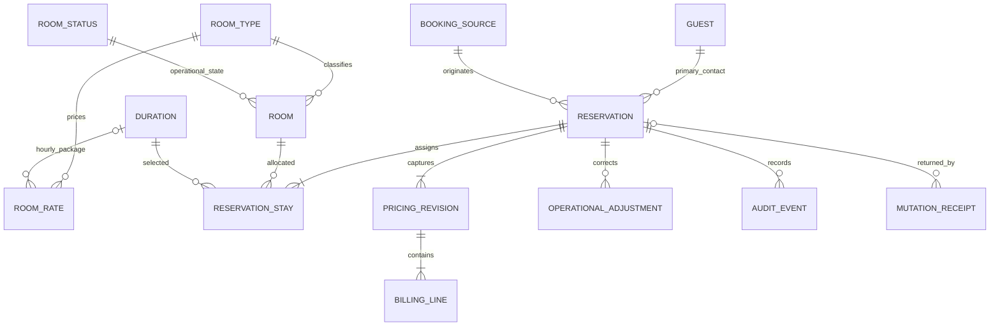
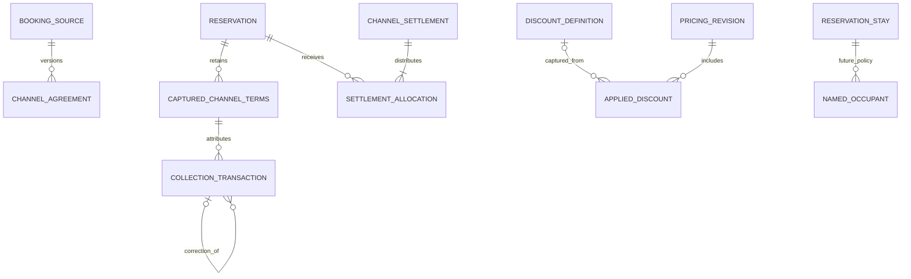
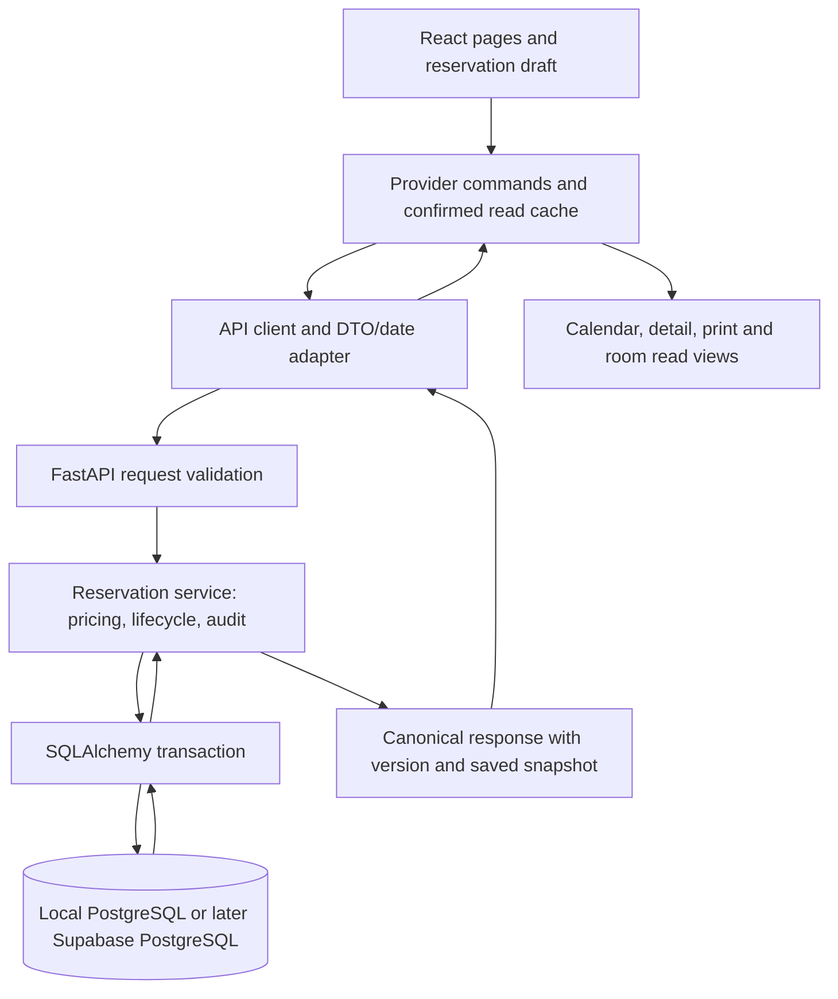

# HMS backend sprint feasibility and architecture review

Review date: 2026-10-12, Asia/Manila. Sprint: Tuesday October 13 through Saturday October 17, 2026. **Consultation only: no backend implementation, dependency installation, database connection, table creation, migration generation, application/test change, or service startup was performed.**

## 1. Executive assessment

**A working local PostgreSQL reservation slice is achievable in five days; persistence of the entire current HMS is not a credible commitment. Recommend Plan B with explicit feature limits and daily completion gates.** The proposed sequence leaves transactions, pricing authority and concurrency until Friday, after Thursday would already introduce writes. Those safeguards must accompany the first write endpoint.

The frontend already implements more than five simple CRUD entities: multi-room/custom stays, captured room/catalog prices, ordered discount allocations, channel agreement snapshots, verified collection corrections, batch settlements, occupancy locks and human-readable audit. Persisting those faithfully requires domain decisions, serializers, transactions and backend validation, not just SQLAlchemy models for frontend interfaces.

Tuesday's three defect fixes are **already implemented**. Current source contains checked UUID adjustment generation/removal/save validation, shared room validation and metadata preservation, and the shared accurate calendar stay layer. The preserved remediation report records 177 unit tests, 27 targeted browser passes and lint/build passes. Read-only SHA-256 comparison of all 77 recorded non-test application files found **no changes since that evidence**. Checks were not rerun for this consultation. The older FINDINGS document is historical and still lists pre-remediation failures; use the dated remediation evidence for their current status.

Treat the sprint as one experienced implementer with roughly 30–35 focused hours total and short owner reviews. Experience, availability and backend familiarity are unknown; this is an estimate, not a promised delivery date. If environment setup or the first reliable reservation write exceeds its day gate, reduce to Plan A rather than omit financial/concurrency safeguards.

Recommended Saturday result: one local persistent mode for a single hotel and PHP, guests, seeded reference configuration, direct reservations with hourly/nightly pricing and room assignments, captured prices, limited signed adjustments, atomic lifecycle/audit changes, conflict protection, and reproducible migrations on two local databases. OTA accounting, collections/refunds, full discounts/catalog editing and hosted deployment remain next-week work. This is a deliberately smaller supported workflow, **not feature parity with the demo**; approval of that limitation is required.

## 2. Current architecture inventory

| Area | Repository evidence | Meaning for persistence |
|---|---|---|
| Frontend/build | `package.json`: React 19, TypeScript, Vite, React Router; Vitest and on-demand Playwright | Existing frontend/tooling can stay. No backend dependencies or package structure found. |
| Routing | `src/app/router.tsx`, `src/app/layouts/*` | Dashboard, reservations, detail/print, Rooms, Guests, configuration, discounts, inventory and cosmetic login routes. No authenticated route guard established. |
| Business store | `src/app/ReservationDemoContext.tsx`, `reservationDemoStore.ts` | Separate `useState` arrays for reservations, stays, guests, settlements and configuration; initialized from fixtures. Raw React setters are exported. |
| Seeds | `src/data/demoReservations.ts`, `datasample.ts`, `channelSamples.ts`, `features/configuration/sampleConfiguration.ts` | Demo bookings, historical rates, fictional financial examples and guest CRM decoration. They are not a production import source. |
| Reservation entry | `src/components/reservations/ReservationPane.tsx` | Large shared create/edit draft, business validation, prices, full snapshots and audit construction. Its `async` submit currently invokes save callbacks without awaiting them. Merely changing a callback to an API call would close/reset before failures are known. |
| Reservation commit | `DashboardPage.tsx` creation/save handlers; `ReservationDetailPage.tsx:saveReservation` | Independently replace reservation state and recreate/replace calendar stays. This must become one server command, not two HTTP requests. |
| Guest creation | Pane `createGuest`, page `onGuestCreated` callbacks | Guest is added to provider before reservation Save. Current discard does not establish transactional guest+reservation creation. Decide whether guest creation is independent or bundled. |
| Room/configuration writes | `RoomsPage`, `ConfigurationPage`, `InventoryPage`, discounts editor, `BookingChannelsEditor` | Direct configuration setter calls, often reconstructing complete entries or replacing arrays. They cannot remain writable in live API mode if their data is only local. |
| Pricing | `roomPricing.ts`, `reservationDraftPricing.ts`, `reservationPricing.ts`, `discountPresets.ts`, `money.ts` | Domain rules already tested in TypeScript. Python cannot import them directly. Port supported rules with parity fixtures; do not trust submitted totals. |
| Operational lifecycle | `reservationLifecycle.ts`, `useReservationActions.ts` | Check-in/out/cancellation/no-show/departure update multiple snapshots, stays, room readiness/locks and audit. React batching is not a database transaction. |
| Availability/calendar | `utils/availability.ts`, `lib/calendar.ts`, four calendar views and `CalendarStayLayer.tsx` | Current overlap is half-open; checked-in/locked stays block independently of their interval. Geometry is presentation; authoritative allocation checks belong on server/DB. |
| Channel finance | `features/channels/types.ts`, `channelFinance.ts`, `channelActions.ts`, `ChannelFinancials.tsx` | Guest debt, collector, commission estimate, confirmed liability, expected settlement, entitlement and payouts are distinct operational records. Not a journal. Significant extra scope. |
| Audit | `ReservationAuditEntry`, pane `buildAuditEntries`, `reservationAudit.ts`, `ReservationAuditHistory.tsx` | Audit is a nested array with textual actors and serialized before/after strings, without stable event IDs. Backend must construct trusted events. |
| Tests | 31 Vitest files in last verification; `booking-tests/` reports/matrix/scripts | Strong regression baseline; currently relies on fresh seeded memory, SPA navigation and browser-controlled time. No real PostgreSQL concurrency/API tests. |
| Backend search | No project `.py`, SQL migrations, Alembic configuration, Python manifest or Supabase backend implementation found | Infrastructure, API contracts, schema and DB tests start from zero. Absence applies to this repository, not installed machine software. |

Host read-only checks found Python **3.11.16** at `C:\ZKBioTime\Python311\python.exe`, `psql` under `C:\ZKBioTime\pgsql\bin`, and Docker under Docker Desktop. No database credentials, service health, PostgreSQL version, running Docker daemon, WSL readiness, or connection privileges were inspected. Do not repurpose the ZKBioTime environment, modify its database, or assume it is an HMS development instance. Use a project-owned virtual environment and an isolated HMS PostgreSQL instance/database with explicit ownership.

Important source contracts: [room pricing](../room-pricing.md), [discounts](../discounts.md), [booking channels](../booking-channels.md), [defect investigation](../investigations/hms-defect-clarification.md), [verified remediation](../investigations/hms-defect-remediation-results.md).

## 3. Existing capabilities versus missing capabilities

| Implemented in the frontend | Simulated or missing |
|---|---|
| Guest selection/creation, physical rooms and reference configuration | Durable storage, loading/error contracts and real identity |
| Create/edit reservations, multiple/custom room stays and calendar views | Persistent room assignment IDs, API transport and date hydration |
| Captured prices, discount calculations, adjustment identities | Server-authoritative calculation, immutable historical revisions and cross-client uniqueness |
| Lifecycle/readiness/occupancy behavior | Atomic DB transitions, concurrent booking/edit protection and server clock |
| Collection/refund/reversal, commission and settlement UI/domain functions | Actual banking, authenticated confirmation, persistent append-only financial records |
| Readable audit and guest print layouts | Server-produced event identity and attributable durable history |
| UI capability boundaries, all granted in demo | Authentication, real server authorization and deployment security |
| Tax-basis labels and zero-tax placeholder | Tax computation, statutory invoicing and official accounting posting |

No `fetch`/local-storage persistence layer was found in the inspected business-state paths. Reload initializes fixtures again. No installed machine tool or frontend login screen proves backend readiness.

## 4. Proposed backend architecture

Use one FastAPI application and one PostgreSQL database. Add a sibling directory `HotelSystem/backend/` later, after plan approval. Avoid microservices, a generic repository framework, Odoo SDKs or direct browser-to-database writes.

Suggested structure, **not created during this review**:

```text
HotelSystem/
  src/                         existing React application
  backend/
    pyproject.toml             pinned runtime/test dependencies
    .env.example               names and placeholders only
    app/
      main.py                  application, CORS, health endpoints
      settings.py              environment-specific settings
      db.py                    engine, request session, metadata
      models/                  relational operational entities
      schemas/                 create/edit commands and read DTOs
      api/                     guests, reference data, reservations, lifecycle
      services/
        reservations.py        aggregate transaction boundary
        availability.py        allocation/occupancy checks
        pricing.py             supported authoritative calculations
        audit.py               event construction
      seed.py                  explicit safe development command
    alembic.ini
    migrations/                reviewed, committed Alembic history
    tests/                     API, pricing parity, PostgreSQL integration
  docs/planning/               plan and later setup instructions
```

Recommendation: SQLAlchemy 2-style ORM with a synchronous PostgreSQL driver and ordinary synchronous FastAPI DB endpoints initially. Avoid introducing async sessions without a concrete throughput need. A request owns its session; service operations define one transaction, and always rollback failed writes. Never share sessions across requests/threads. [SQLAlchemy session guidance](https://docs.sqlalchemy.org/en/20/orm/session_basics.html) supports this ownership model. FastAPI's [relational database tutorial](https://fastapi.tiangolo.com/tutorial/sql-databases/) shows dependency-managed DB access, but its SQLModel examples do not require adding SQLModel to the proposed SQLAlchemy stack.

Use Pydantic request/response schemas separate from ORM entities. Create/edit schemas accept authorized intentions: guest/source IDs, assigned room IDs, per-room scheduled stay, supported adjustment commands and expected version. They do **not** accept trusted actor, lifecycle status, actual timestamps, occupancy locks, captured prices, computed totals or audit arrays from the browser. Those are server-managed fields.

Initial proposed endpoints: reference-data read; guest search/create; reservation list/detail/create/edit; explicit check-in, checkout, cancel, no-show and departure commands; room readiness command if brought into persistent scope. Use `/api/v1`. An availability endpoint is useful but not authoritative permission to Save. Readiness/configuration writes not delivered must be explicitly read-only in persistent mode.

## 5. Initial database entity recommendations

### Model readiness

“Ready” means the semantics can inform a contract, not that the TypeScript interface can be copied into SQL unchanged.

| Concept | Classification | Recommendation / rationale |
|---|---|---|
| Guest | Ready with normalization | UUID, trimmed required name, nullable or normalized optional contacts under one documented policy. Do not invent unique-email or mandatory-phone rules. `SampleGuest.segment/stayCount` are demo/presentation data, not required business truth. |
| Room Type | Ready with normalization | Stable PK, label, enabled/archive, optional capacity/defaults. Rates and durations are separate references. Disable rather than delete historically referenced types. |
| Physical Room | Requires normalization | UUID, case-insensitive unique room number, type/status FKs, readiness, optional override, metadata. Stable room ID is the assignment reference; keep captured number/label for historical display. |
| Reservation | Requires normalization | Aggregate root: UUID, server-generated unique business code, guest/source FKs, status, scheduled/actual times, version and creation metadata. Nested rooms/pricing/audit become read-model composition. |
| Stay / reservation room | Requires normalization | Persistent room allocation row with room and reservation FKs, own dates, occupancy counts, captured room labels/type/rate and actual times. One source of scheduled assignment truth; calendar `Stay` becomes a projection. |
| Reservation Occupant | Lifecycle/policy clarification; defer names | Current model only has adult/child counts and breakfast guest ordinals. No named room-occupant entity exists. Do not fabricate occupants or convert “Guest 1” to a real person. Keep existing counts pending agreed whole-guest/capacity policy. |
| Booking Source | Ready; agreements need normalization | Seed/read direct source for sprint. External reference uniqueness/channel agreement dates require policy before full OTA persistence. |
| Duration/rate/status/settings | Essential references | Not in original five-model list, but server pricing and lifecycle depend on them. Seed them and expose read API. Keep historical captured values separate from current settings. |
| Pricing Snapshot | Requires normalization; essential | Server-produced immutable revision with currency, pricing version, captured lines/totals and provenance. JSONB detail is acceptable for ordered breakdown, not as a substitute for relational assignments or monetary authority. |
| Inclusion | Requires normalization; defer editing | Definition/default versus saved selection/origin are different. Included items need captured labels/quantities; don't equate inclusion with purchasable stock. |
| Purchased Item / Extra Charge | Requires normalization; defer new writes in narrow plan | Capture identity, usage, catalog FK when available, price/quantity/tax description and room allocation. No implemented inventory stock ledger to persist. |
| Discount | Requires normalization; defer full pipeline in Plan B | Separate reusable definition from captured application and line allocation order. Manual room scope includes extras; final-price offers precede reductions. Must port faithfully before enabling. |
| Financial Adjustment | Ready for operational correction; lifecycle deferred | Stable ID, reservation relation, signed minor-unit amount, reason and created/changed actor/time; audited retirement/correction for unposted entries. No posting or journal semantics on Save. |
| Payment / Collection | Requires normalization/lifecycle clarification; defer writes | Separate positive recorded collections from refunds/reversals; collector and channel agreement attribution matter. Evidence/time/actor required; guest collection is not hotel payout. |
| Refund | Requires linkage/limits clarification; defer | Existing corrections are appended, but no explicit original-transaction link in the interface. Persistent model should link correction to origin and enforce concurrent cumulative limits. Automatic cancellation refund policy remains unspecified. |
| Audit Event | Requires normalization; essential | UUID/sequence, aggregate ID/version, event type, before/after JSON, timestamp and actor attribution level. Server generated and append-only; frontend description remains derived. |
| Channel settlement/allocation | Requires normalization; defer | One settlement may cover several reservations. Not a nested reservation table or a guest payment. Needs separate transaction/allocation records and reconciliation audit. |
| Calendar positions, guest counts summary, current balance | Can remain derived | Coordinates, colors, availability hints and CRM activity counts are presentation/read models. Balance calculated from authoritative saved charges/transactions; don't maintain an independently editable duplicate. |

### Essential schema boundary

Plan B core: guest, room type, room status, physical room, duration, room rate, hotel settings, booking source, reservation, reservation stay/allocation, pricing revision, billing line, operational adjustment, audit event and mutation receipt. Some one-to-one settings may be a single row; no multi-property framework is needed.

Recommended IDs: UUID internal keys; separate database-generated unique human code such as `RES-00042`, using a sequence rather than frontend max-plus-one. Sequence gaps after rollback are acceptable unless the owner requires an official invoice numbering policy; reservation codes are not invoice numbers. Existing fixture IDs (`guest-…`, `DEMO-…`, `room-101`) are not all valid UUIDs. Future import must map legacy IDs explicitly, never silently cast/rekey money/audit references.

Existing calendar `Stay.id` is numeric and generated using max-plus-one. The transport adapter must translate to a compatible read model or the view contract must explicitly accept server IDs; do not shoehorn a UUID into a number. Existing routes use reservation business-facing IDs. Provide a lookup by code for deep links while mutation commands use stable server identity/version. Room edits must not cascade guessed string renames.

### Essential relationships



Logical cardinalities describe the supported saved aggregate; optional FK rates/legacy references need explicit historical handling. `ROOM.current_occupancy_stay_id` may point to a stay as a protected current occupancy reference (at most one per room); its consistency is transactional and should include room ownership validation. Do not also maintain three independently writable lock arrays.

Deferred relationships, **not initial sprint tables**:



### Snapshot versus relational storage

Normalize rooms, allocations, guest/source references, adjustment identities and audit identities. Keep an immutable server-validated snapshot of exact displayed historical charges, labels, rates, line allocations and calculation version alongside relational operational rows. A narrow JSONB payload can preserve ordered pricing detail during schema evolution; it must have a documented version and server producer, not accept arbitrary full frontend snapshots. Do not freeze every mutable guest/configuration attribute into every row, and do not recalculate an old invoice-like print from current configuration.

Suggested revision model: an accepted bill-changing edit creates a new `pricing_revision`; the reservation references its current revision. Unrelated notes/contact edits preserve the existing revision. Keep the original raw audit facts and previous revisions. Physical deletes of saved unposted adjustments are avoided: mark retired/changed state and audit the accepted correction, projecting only current applied entries into the UI. This is operational history, not accounting reversal or posting.

## 6. Frontend integration approach

| Option | Benefit | Problem in this repository | Assessment |
|---|---|---|---|
| A: API-backed provider internals with existing raw setter API | Few initial page changes | Arbitrary `setConfiguration(current => …)` and multiple setter calls cannot infer an atomic server command or reliably report async failure | Do not emulate network persistence behind unchanged setters |
| B: dedicated API/DTO adapter under providers, explicit commands exposed | Keeps page layout/read selectors and centralizes async transport | Small deliberate changes required at actual mutation boundaries | **Recommended: B plus a thin API-backed provider cache** |
| C: API query/mutation hooks in each page | Better later targeted fetching/invalidation | Broad simultaneous page refactor, possible duplicate caches and extra library choices | Defer until access patterns justify it; no new query library prerequisite |

Retain local pane draft state. Replace fixture bootstrap in persistent mode with explicit loading of references/guests/reservations; the provider owns a coherent confirmed read cache. Replace raw persistent setters with `createReservation`, `updateReservation`, lifecycle and other supported commands. Unsupported editor paths must be disabled/read-only in that mode. Keep demo mode explicitly separate; a backend outage must never quietly fall back to demo fixtures.



Minimum state handling:

- **Loading:** distinct initial-loading/loaded/error states. Empty arrays do not mean successful load. Do not show “reservation not found” or available rooms before relevant data is loaded.
- **Dates:** request offset-aware ISO strings; hydrate response timestamps once into `Date` values before existing `.getTime()`, comparisons and calendar helpers. Preserve precision and hotel-zone display. Breakfast service dates remain date-only, not UTC instants.
- **Saving:** callbacks return/await a Promise. Keep draft open and Save pending until commit succeeds; error retains draft. No pre-commit calendar insertion or success notice. Disable duplicate Save while pending, but also require server idempotency.
- **Failure:** validation errors attach to fields; conflict/version failures remain visible with reload/review options; network failure is distinct from rejected input. Unknown write outcome retries with the same idempotency key, never a new booking request blindly.
- **Stale data:** return canonical reservation, affected room/readiness state and versions after commit; update related cache together or refetch the aggregate before allowing more commands. Invalidate availability after accepted mutations. Refetch on window focus and before sensitive operations; continuous realtime can wait.
- **Concurrent edits:** submit loaded version; return 409 for stale edits, retain the draft and offer explicit comparison/reload. Never automatically overwrite someone else's changes.
- **Retry:** retry safe reads within a small bound; no endless spinner and no silent fixture fallback. Writes use operation identity plus request-body hash and a transactional mutation receipt.
- **Guest draft:** default recommendation is independent guest Save with clear UX; if owner prefers “discard reservation discards newly created guest,” bundle guest creation with the reservation command. This decision must precede pane wiring.

The API client should send command intentions, not upload the pane-generated audit/pricing as authoritative data. Preview calculations can remain local; an optional server quote endpoint is a stretch improvement, not permission to trust a preview at commit.

## 7. Transaction and concurrency strategy

### Transaction matrix

| Operation | Records affected | Atomicity / validation | Concurrency protection | Audit requirement |
|---|---|---|---|---|
| Guest creation | Guest; optional mutation receipt | Required name, established contact rules; standalone unless bundled policy approved | UUID/receipt; no invented unique email | Created actor/time; guest audit expansion can follow |
| Reservation create | Reservation, all stays, initial pricing/lines, applied adjustments, audit, mutation receipt | All succeed or all rollback; valid IDs/rates/currency/dates, supported features and availability | Lock selected room rows in stable order; overlap exclusion; same-request replay returns same record | One accepted operation with captured server facts |
| Reservation edit / reassign / extend | Aggregate, affected old/new rooms/stays, pricing revision when needed, audit | Validate full resulting assignment set excluding own rows; preserve unrelated captured prices and actual timestamps | Lock reservation/version and old+new room union in fixed order; reject stale version | Before/after changed facts, no fabricated client events |
| Add/remove operational adjustment | Adjustment current state, pricing revision, reservation version, audit/receipt | Nonempty unique ID, finite nonzero signed amount, reason; no ambiguous legacy mutation | Reservation lock/version plus PK/UNIQUE; recompute current total server-side | Retain prior saved correction and attribution |
| Check-in | Reservation/stays actual time/status, room current occupancy, audit/version | All rooms active, clean, operational, correct type and within each stay window; no conflict | Shared allocation/room locking protocol; unique room occupancy | Server timestamp and accepted transition |
| Checkout | Reservation/stays actual departure, room readiness/occupancy, audit/version | Only checked-in; release all occupancy and set all rooms Dirty together; scheduled history preserved | Same locking protocol; no partial room release | Transition and affected rooms |
| Cancel / no-show / departure | Reservation/stays, reservation-blocking state, room occupancy/readiness, audit | Explicit domain transition guards; cancellation guest-present choice retains lock; departure releases it; no automatic refund | Reservation/version + all rooms; check-in/cancellation race serializes | Accepted decision; no payout/payment inference |
| Room readiness | Room/version, audit | Existing occupied/locked guard, valid readiness; required optional normalization | Room lock shared with lifecycle/create operations | Old/new readiness and actor |
| Reference/config edit | Type/rate/status/etc; configuration version | Referential/historical rules; cannot deactivate active assignments silently | Lock affected rows; conflicting config/booking reads serialized as needed | Configuration audit if delivered; otherwise read-only |
| Future collection/refund | Collection corrections, aggregate balance/version, audit/receipt | Same-currency evidence, linked origin, bounded cumulative refunds | Lock reservation/collection group; idempotency/unique IDs | Append-only original/correction events |
| Future settlement batch | Settlement, allocations, every affected reservation audit | Sum matches, same source/currency attribution, all-or-nothing | Sorted aggregate locks; unique request identity | One batch plus per-reservation allocation facts |

The current cancellation helper lacks an explicit allowed-status guard; UI hiding is not sufficient for public API calls. Define backend transition validity before exposing commands. Current calendar `Stay.checkOut` can become actual departure on checkout while saved room scheduled checkout remains historical. Design explicit scheduled/actual fields and projection rules instead of persisting that overloaded field as one timestamp.

### Constraint versus service versus presentation

**Database:** PKs/FKs, unique business codes and case-insensitive room numbers; one current occupancy reference per room; allowed values and nonempty required IDs/names; `scheduled_end > scheduled_start`; nullable positive integer capacity; nonzero adjustments; adjustment identity uniqueness; nonnegative charge minor amounts; currency consistency structure; version and idempotency uniqueness. FKs restrict destructive deletion of referenced rooms/rates/sources; archival preserves history. Cross-row amounts, minimum one assignment and aggregate consistency need transactional validation in addition to individual row CHECKs.

**Service inside transaction:** rates active for new selections, historical rates preserved for unrelated edits, pricing recomputation, no unsupported workflow acceptance, lifecycle guards, room readiness, occupied-lock restrictions, refund limits, snapshot provenance, multi-room atomicity and server audit. A DB UNIQUE alone cannot establish a valid bill or permitted transition.

**Frontend:** responsive pane layout, draft interactions, labels, visual geometry, tooltip/disclosure, navigation and provisional availability. Reuse calendar helpers; do not move pixel geometry into SQL.

### Scheduled overlap and physical occupancy are different

Use a PostgreSQL `tstzrange` overlap exclusion by room for active scheduled allocations, with **[start, end)** boundaries so touching stays are permitted. Index only blocking assignments; because an exclusion predicate cannot consult the parent reservation status, maintain a service-controlled blocking state on the allocation in the same transaction. PostgreSQL documents range exclusion and equality combinations through `btree_gist`; Supabase lists that extension. Validate the actual selected server's extension/version support on Tuesday. Sources: [PostgreSQL range constraints](https://www.postgresql.org/docs/current/rangetypes.html), [Supabase extensions](https://supabase.com/docs/guides/database/extensions).

This exclusion does **not** reproduce `findClash`'s all-time checked-in/occupancy-lock rule. Every booking/edit/readiness/lifecycle operation must lock the physical room row and recheck current occupancy after obtaining the lock. New assignments to an occupied/locked room are rejected regardless of scheduled end, matching current behavior. Existing legitimate future reservations are not deleted when another reservation checks in.

**Do not represent current occupancy as an infinite scheduled exclusion range:** checking in a guest could then collide with a future booking already legitimately saved, even though the current frontend permits that sequence. Keep a protected current-occupancy reference separate from the scheduled-range constraint. Checking in, cancelling while still present, departure and checkout update it atomically.

Lock reservations in ascending UUID order when more than one is involved, then rooms in ascending UUID order, consistently across all services. An edit locks the union of old and proposed room IDs. Take locks before evaluating mutable occupancy/configuration facts. Row locking serializes room-sensitive checks; unique/exclusion constraints remain the last barrier against conflicting inserts. Handle deadlocks/serialization errors with bounded whole-transaction retries that retain the operation key. [PostgreSQL locking guidance](https://www.postgresql.org/docs/current/explicit-locking.html) describes row-lock blocking and deadlock avoidance.

Use optimistic reservation versioning for stale form edits in addition to pessimistic room locks. A version mismatch must fail the full command. SQLAlchemy's version counter only covers relevant ORM flush operations; bulk update/delete bypasses that mechanism, so explicit conditional writes or ordinary version-aware ORM updates are required. Source: [SQLAlchemy versioning](https://docs.sqlalchemy.org/en/20/orm/versioning.html).

Idempotency receipt design: unique `(operation_scope, request_key)` plus body hash and canonical resource/result in the same transaction. Replaying the same key/body returns the original result; reusing the key with a different body fails. No partially committed receipt before the reservation. Sequence code generation and UUID record identity are separate from request identity. Transaction failures do not produce successful audit entries for changes that never committed.

## 8. Financial boundary and local-to-Supabase strategy

### What must persist now

Saved room charges, currency, captured rate/nights/package quantity, supported signed adjustments, pricing revision and audit are part of a trustworthy reservation. They cannot be added as optional integrity later on Friday if Thursday starts accepting reservations. Plan A can defer editing the bill, but still captures a server-calculated accommodation snapshot.

Friday's full proposed scope is too large if it means porting all discounts, extras, OTA overrides, collections/refunds, commission, settlement and source history. Plan B limits monetary writes to accommodation plus ordinary operational adjustments. It does not accept client-calculated discounts/OTA totals and quietly store them as approved. Unsupported actions are clearly gated in persistent mode.

Preserve a future integration boundary: stable operational IDs, revision/provenance, correction history and eventual external accounting references can support Odoo. **Reservation Save is not accounting posting.** No journals, finalized invoices, automatic refunds or posting/reversal workflows this sprint. Future posted entries become immutable and use linked reversals; do not implement speculative `posted=true` toggles or silently treat collection verification as posting.

### Money, time and schema conventions

- Prefer signed integer minor-unit money (`BIGINT`) with explicit currency for captured charges/adjustments. Bound API values to the frontend's safe integer range, not the wider DB range alone. Current channel decimals are exact-parsed; rate inputs can have extra decimal precision. Represent configurable unit inputs with bounded decimal precision where required, then round at the documented boundary before multiplying. Do not prematurely truncate a 1.005 configured nightly rate to 1.00, or use Python's default bankers' rounding for the current half-away-from-zero policy.
- Freeze PHP/two-decimal operation for the narrow slice only with approval. Existing code supports currency metadata/precision; foreign currency and conversion are not automatically tested. Percentage basis points and ordered allocations belong to a later parity-tested discount implementation.
- Use `timestamptz` for instant fields and offset-aware ISO API values. PostgreSQL stores timestamp-with-time-zone instants internally in UTC, not the original hotel time-zone label; keep hotel timezone `Asia/Manila` as a separate setting. Use date fields for service dates and agreement effective dates. Source: [PostgreSQL datetime types](https://www.postgresql.org/docs/current/datatype-datetime.html).
- Server clock controls recorded creation/actual/audit times. Deterministic backend tests need a controlled clock too; the existing browser-only clock cannot change FastAPI's time.
- Snapshot schema version is separate from Alembic revision and pricing-calculation version. Add compatible fields, migrate/backfill deliberately, keep read DTO compatibility; don't recalculate old monetary history during schema upgrades.

### Local foundation

Docker is useful for isolation and repeatable PostgreSQL versions, **not necessary** for FastAPI/PostgreSQL or future Supabase. Prefer a pinned isolated PostgreSQL container if Docker Desktop already works; otherwise use a dedicated project-owned native instance. Do not spend the sprint repairing WSL/Docker or reuse an unrelated application DB. Record a tested supported Python version and dependency lock later; current PATH Python alone does not establish dependency compatibility.

Use a PostgreSQL major version compatible with the selected future Supabase project and required extensions; inspect that project's actual version later. Do not assume the latest local release and hosted major match. Set up separate `hms_dev`, integration-test and second verification databases. Never use SQLite as proof of PostgreSQL exclusion/locking behavior.

Use an isolated application schema such as `hms` and narrow runtime permissions, plus a separate migration role. Alembic is the schema authority. Do not mix dashboard edits, automatic `create_all` startup, ad hoc SQL and multiple competing migration histories. Review generated revisions, naming/FKs/backfills and extension/exclusion operations explicitly. Autogenerate is a draft and has documented limitations for exclusions and CHECK expression detection. Source: [Alembic autogenerate limitations](https://alembic.sqlalchemy.org/en/latest/autogenerate.html).

### Connection change is not a data migration

The same FastAPI service can connect to local or hosted PostgreSQL using environment settings; the React app continues to call FastAPI. No Supabase frontend SDK is required just to host PostgreSQL.

For a long-running backend, evaluate direct or session-pooler connections. Supabase documents IPv6 direct endpoints and an IPv4 session-pooler alternative; transaction pooling has prepared-statement/session-state restrictions. Copy actual credentials/endpoints from the project's Connect panel and test the chosen driver. Use an appropriate direct/session connection for reviewed migrations. Source: [Supabase connection guide](https://supabase.com/docs/guides/database/connecting-to-postgres).

**Schema deployment:** apply the reviewed Alembic history to a clean hosted staging database. **Data transfer:** separately export/import approved real records with ID mapping, ownership, reconciliation and validation. Changing `DATABASE_URL` does not transfer local rows. Do not copy fictional demo guests, financial examples or development bookings into production. Restoring an arbitrary entire local cluster is not a substitute for controlled application-schema migration.

### Documented migration workflow — do not execute during consultation

1. Provision an isolated empty local HMS database and explicit runtime/migration roles; verify version, ownership and `btree_gist` capability. Set secrets outside Git.
2. Apply committed Alembic revisions using the migration connection: later documented command `alembic upgrade head` from the backend environment. Verify named constraints, tables and current revision.
3. Run an explicit development seed command that checks environment/database identity, seeds minimal reference data idempotently and refuses production targets. Seed fictional bookings only under a separate optional demo flag. Startup never reseeds or overwrites existing data.
4. Start FastAPI on loopback with the correct environment; verify liveness and a real DB readiness query.
5. Start React with its public API URL and explicit persistent mode. Configure exact local CORS origins. Do not put DB passwords in `VITE_*` variables.
6. Create and edit a reservation; record IDs, version, times, captured amounts and audit. Refresh browser; restart backend; reconnect DB client. Verify stored values still agree. Browser refresh alone only proves one part of persistence.
7. Apply the same revisions/seed to a second empty local database. Repeat the workflow; verify seed rerun creates no duplicate data. Test upgrading an earlier revision with a saved booking without erasing its snapshots.
8. Later provision hosted staging, check PostgreSQL/extension/schema permissions, configure verified TLS and secrets, then run the same migration chain once through a designated migration process. Perform CRUD/conflict and restore smoke tests before production consideration.
9. If transferring approved real data later, design a separate export/import procedure with backups, row counts, FK checks, identity mapping, totals/audit comparison and owner sign-off. Development seeds are not that procedure.

Alembic revision generation commands are implementation work after approval; no migration scripts or backend files exist from this review. A destructive reset/downgrade is acceptable only for disposable development databases; production recovery should prefer a reviewed forward fix or tested restore.

## 9. Deployment readiness: implement now versus document later

| Concern | Minimum during local sprint | Later hosted requirement |
|---|---|---|
| React/FastAPI hosting | Document ports/API URL; loopback only | HTTPS frontend and separately hosted FastAPI; Supabase DB alone does not host Python application |
| Configuration/secrets | Ignored environment file, validated settings, placeholder example | Managed secrets, rotation, distinct staging/production roles and credentials |
| Authentication | Explicit local-only developer attribution, no claims of real identity | Authenticated API authorization before shared/external access; choose auth approach separately |
| DB access | Isolated schema, least-privilege runtime, reviewed migration role | Verified TLS, pool sizing, network access, connection health; no DB/admin secrets in browser |
| Supabase Data API | Document no direct frontend DB access | Keep application schema unexposed or use reviewed grants/RLS if exposed; database hosting does not automatically secure a custom FastAPI API |
| Migrations | Tested empty/upgrade paths, one committed history | Single controlled deployment migration job, staging rehearsal, rollback/forward-fix plan |
| Backup/recovery | Local logical backup/restore rehearsal into disposable second DB | Approved recovery objectives, backup policy and restore drills; verify plan-specific features |
| Logging/health | Structured request IDs, errors and liveness/readiness; redact credentials/guest contact | Central logs/alerts, retention/privacy, latency/pool monitoring |
| Failure behavior | Explicit unavailable state, retained draft, transactional rollback | Operational recovery and load/chaos/security testing |

Supabase's [RLS guidance](https://supabase.com/docs/guides/database/postgres/row-level-security) covers exposed-schema policies and privileged access; privileged keys must never be shipped to the browser. For this architecture, FastAPI owns business authorization and SQL access; Supabase Auth JWT context is not magically attached to an arbitrary SQLAlchemy session.

Use encrypted hosted DB connections with certificate/hostname verification where supported. Connection configuration must be tested, not inferred from an environment variable alone. Hosted backup availability/retention and recovery features depend on actual service setup; document and verify them before deployment. See [Supabase connection security](https://supabase.com/docs/guides/database/connecting-to-postgres) and [backup documentation](https://supabase.com/docs/guides/platform/backups).

No public or LAN deployment without real authorization is a sprint deliverable. A placeholder actor can support local development audit only if stored and labelled as such.

## 10. Feasibility of the original sprint

Estimates are focused engineering hours including local verification, not elapsed provisioning waits. They are deliberately ranges; full frontend parity can exceed them substantially.

| Original day | Classification / complexity | Prerequisites | Risks, unknowns and blockers | Verification / adjusted scope |
|---|---|---|---|---|
| Tue 13: frontend fixes | **Realistic; already delivered**, 1–2h to review baseline rather than redo | Current source/evidence, stable dirty-tree baseline | Older FINDINGS misleading; uncommitted work must be preserved | Review dated report/hash; allocate remaining day to contracts, isolated DB and transaction design |
| Wed 14: DB/FastAPI/models | **Ambitious but possible**, 6–10h | Setup choice, Python environment, model/identity decisions | Five suggested entities omit rates/durations/status/settings/audit; unknown daemon/DB privileges | Migrate empty DB and seed minimum references; start read API; avoid full-model parity |
| Thu 15: persistent reservations/UI | **Unrealistic without reducing scope**, 10–16h for broad flow | Transactions, backend price authority, DTO/date/version contracts | Unawaited callbacks, raw setters, dual stays/snapshots, concurrency and unsupported editor paths | Restrict supported commands; first persisted Save must include audit/pricing/conflict checks |
| Fri 16: billing/integrity | **Unrealistic without reducing scope**, 12–20h | Stable aggregate write path and parity-tested pricing | Full discount/OTA/collection semantics much larger than three nouns; unresolved occupant/refund policy | Limit to accommodation/operational adjustments; integrity cannot be deferred until this day |
| Sat 17: migration readiness | **Realistic only if prepared earlier**, 4–8h | Reviewed migrations, isolated DBs, restartable slice | Last-day schema changes, hosted assumptions and backups not tested | Second DB, upgrade/restore checks, runbook; hosted migration path documented, not hosted deployment |

The original plan has roughly **33–56 hours remaining even after completed frontend work**, plus owner reviews/setup surprises. Thirty focused hours cannot safely absorb its upper range. Requirements blocking full scope include guest-count/capacity policy, contact rules, cancellation refunds, real actor identity and external financial evidence rules. Core persistence can proceed with agreed narrow scope; those unresolved rules must not be guessed.

## 11. Alternative sprint plans

### Plan A — Conservative

| Day | Concrete deliverable and acceptance |
|---|---|
| Tue | Approve slice/contract and isolate tools/DB; one backend readiness check, schema draft and version/ID/date rules agreed |
| Wed | Alembic foundation, reference seed/read API and guest create/search; second seed run produces no duplicate references |
| Thu | Direct single-room create/read with server room pricing, captured snapshot, audit, idempotency and overlap protection; persists through backend restart |
| Fri | Narrow date/note edit with version rejection and preserved prices; wire pane/read views with clear unsupported-control gates; two clients race and only one conflicting booking commits |
| Sat | Second empty database setup, upgrade/restart tests, backup/restore and documented Supabase path; lint/unit/build and selected persistent-mode UI checks |

Expected Saturday: reliable direct single-room booking creation/read/edit; no paid status, complex bill editing or promised full lifecycle coverage. An auditable captured accommodation amount is still persisted. Risk: even this slice fails if environment setup consumes a day or scope gates are not accepted. Budget target approximately 24–30h. Following week: lifecycle/readiness breadth, multi-room/custom stays, signed adjustments and additional billing parity.

### Plan B — Balanced, recommended with hard gates

| Day | Concrete deliverable and acceptance |
|---|---|
| Tue | Reuse verified frontend baseline; approve PHP/direct slice; isolate DB/backend; establish transaction/DTO contracts and initial migration with references; health and schema creation smoke test |
| Wed | Guest + reservation create/read API, captured accommodation pricing, audit and operation identity; constraints and two-client conflict/rollback tests pass before UI integration |
| Thu | API client/provider commands, awaited pane Save, date hydration and canonical cache refresh; reservation detail/calendar/print survive refresh and backend restart; supported edit preserves snapshots/version |
| Fri | Signed operational adjustments with audited history and pricing revisions; essential check-in/out, cancellation/departure/no-show guards and room readiness atomicity; reject stale updates and occupied-room bookings |
| Sat | Freeze features; complete persistent-mode regression, second DB/upgrade/restore rehearsal, seed/setup and hosted-path documentation; reconcile evidence and remaining limitations |

Committed scope: single property, direct/PHP bookings, seeded reference configuration, existing hourly/nightly rate semantics, room assignments with at least the normal same-stay flow, signed adjustments, durable audit and essential lifecycle. Multi-room/custom stays are accepted only when their full transaction tests fit Wednesday's gate; otherwise persistent UI/API explicitly rejects unsupported assignment forms. This fallback is a scope choice needing approval, not a silent reinterpretation of the existing demo.

Do not enable discounts, extras, OTA terms, collections or settlement writes in persistent mode unless separately delivered with server parity. Keep the existing full-feature demo isolated for exploration. Do not import its fictional reservations into the live store. Target approximately 30–35h including 4h contingency; limited review capacity or unfamiliarity can require Plan A.

Expected Saturday: a coherent local operational reservation slice with a bounded bill and real integrity. Following week: full multi-room/custom-stay coverage if deferred, catalog/inclusions/breakfast and discount port, reference editing, authenticated actors, channel snapshots/collection corrections and then settlement integration. Odoo remains a separate later project.

### Plan C — Aggressive

| Day | Concrete deliverable and acceptance |
|---|---|
| Tue | Complete domain/schema/API decisions, local setup and frozen frontend baseline; no unresolved contract decisions carried into implementation |
| Wed | Core plus rates/catalog/discount/channel-related schema and migrations; clear snapshot/reference separation |
| Thu | Broad create/read/edit integration including multi-room/custom stay and complete existing pricing parity; transaction/conflict/version tests must already pass |
| Fri | Discounts, adjustments, audit and essential lifecycle; attempting collections/OTA source history requires separate append-only/API contracts and tests |
| Sat | Full relevant frontend/persistent-mode regression, migration chain/restore and hosted runbook; no late unsafe writes |

Expected Saturday under normal capacity: likely a partial prototype rather than a fully verified integrated flow. Rough effort 45–65+ focused hours for broad billing parity, higher if channel collections/settlements are included. Authentication, production hosting, full financial integration, comprehensive configuration editing or meaningful concurrency testing would be tempting sacrifices; **do not sacrifice the integrity tests**. If those tests cannot fit, reduce feature scope. This plan is not recommended for one implementer with limited reviews. Following week would mostly finish integration/testing and resolve dropped financial policy rather than deliver new architecture.

## 12. Recommended Tuesday–Saturday execution and acceptance gates

Choose bounded Plan B, with Plan A as the explicit fallback. No implementation is authorized by this report.

**Tuesday, six hours:** approximately 1h review/owner scope decisions, 1h isolated tooling gate, 2h schema/DTO/transaction baseline, 2h migration/reference/health foundation. If isolated PostgreSQL cannot be ready within the tooling gate, choose the alternate isolated setup or reduce scope; do not modify ZKBioTime services.

**Wednesday, six hours:** first server-authoritative reservation write/read and PostgreSQL tests. By day end: a saved reservation has stable code/identity, captured room rate, audit, idempotency and a real conflict race test. If this fails, drop multi-room/custom stays and discretionary bill edits; do not begin pretending UI Save is durable.

**Thursday, six hours:** complete one UI flow through provider/API commands; loading and error states, draft retention, server response hydration and detail/calendar/print agreement. Refresh and restart must preserve the same saved values. No raw provider mutation remains reachable for supported persistent writes.

**Friday, six hours:** add operational adjustment correction/revision and lifecycle/readiness transactions, with pricing/version/rollback tests. If full lifecycle cannot fit, expose only delivered commands and explicitly defer the rest. Do not leave enabled local-only buttons beside persistent reservations.

**Saturday, six hours plus remaining contingency:** verification and documentation only. Replay migrations and seed on a second DB, test old-revision upgrade and restore, run project checks and selected browser screenshots against API mode. Document exactly what passed, failed, was blocked or unsupported. No last-minute billing expansion.

Daily owner review should address a concrete working result and remaining scope gate, not redesign the architecture. Saturday delivery requires gates below; if any core gate fails, report an incomplete slice rather than claim persistent HMS completion.

### Measurable acceptance criteria

| ID | Required evidence |
|---|---|
| AC1 — repeatable setup | Empty DB → reviewed migration head → references → startup succeeds on two isolated local databases; seed rerun duplicates nothing and refuses non-development targets |
| AC2 — durable aggregate | Create guest/reservation, refresh browser, restart API and verify fresh reads preserve IDs, dates, room assignments, captured charges and audit; no startup fixture reset |
| AC3 — authoritative money | A forged client total/rate is ignored/rejected; supported hourly/nightly/adjustment golden cases match current documented rounding; +100/+200 on 1100 gives 1400 and removing +100 yields 1300 |
| AC4 — rollback | Inject failure after a stay or billing/audit write; database contains no partial reservation, assignment, price revision, successful audit or committed receipt |
| AC5 — concurrent booking | Two independent DB sessions request overlapping same-room allocations simultaneously; exactly one commits and the other returns conflict; touching endpoints can both commit |
| AC6 — occupancy behavior | Checked-in or cancelled-but-present room blocks a new distant-future booking despite scheduled checkout passing; recording departure releases the lock and marks Dirty; existing future bookings are retained |
| AC7 — stale edit | Two forms load version N; first edit commits N+1, second is rejected without overwriting dates/prices/audit; draft remains available for review |
| AC8 — replay | Lost response/retry with same key/body yields one reservation/adjustment action and one accepted audit operation; changed body with same key is rejected |
| AC9 — price history | Change current configured rate through controlled test setup, then edit only a reservation note; historical saved rate/label/pricing revision remain unchanged; explicit supported duration edit recaptures intended current rate |
| AC10 — UI failure | DB/API unavailable at boot shows unavailable rather than fixtures; mutation failure keeps pane/inputs open; calendar/detail/print never show success for rejected write |
| AC11 — room metadata | Optional field clear maps correctly, ID/archive/lock survive edits; occupied readiness and referenced-room rename guards remain effective for delivered commands |
| AC12 — lifecycle atomicity | Check-in/out/departure transitions update all supported assignments/occupancy/readiness/audit together; forbidden direct API transitions are rejected; test time comes from controlled server clock |
| AC13 — evidence | Existing frontend lint/unit/build checks plus new real-PostgreSQL API/concurrency tests and explicit persistent-mode screenshot cases; original demo reports remain preserved and are not relabelled backend passes |
| AC14 — upgrade/recovery | Upgrade a previous schema with a saved reservation without changing its captured totals/history; restore a local backup into a disposable DB and verify record/audit counts and totals |
| AC15 — scope honesty | Unsupported OTA/payment/discount/catalog actions visibly gated and server-rejected; no mixed demo/live mutation, no public insecure deployment, no claim of production readiness |

Persisted backend tests must use PostgreSQL, not just mocked sessions. Extend the on-demand browser setup later with explicit API mode, known safe development seed and controlled backend clock; existing browser-only fixed time and reload-reset assumptions need separate expectations. No new automated background testing or deployment hooks are required by this plan.

## 13. Risk and dependency register

“Verified” describes current source/evidence; “future” describes a risk introduced by persistence that is not presently browser-demonstrated.

| Risk | Severity | Evidence | Consequence | Mitigation | Required decision |
|---|---|---|---|---|---|
| Refresh data loss | Critical | Verified: provider fixture `useState` bootstrap | Work disappears | DB authoritative bootstrap; no silent fallback/reseed | Confirm live versus demo mode boundary |
| Double bookings | Critical | Future: current `findClash` reads one client's array | Two clients accept same room | Room locks, exclusion constraint and real concurrent test with first endpoint | Confirm constraint/extension strategy; preserve touching boundaries |
| Occupancy mis-modelled as finite/infinite range | Critical | Verified behavior: checked-in/locked blocks independently; future persistence risk | Overdue room admitted, or valid future bookings block check-in | Separate current occupancy from scheduled range; transactional checks | Approve projection/occupancy representation |
| Partial aggregate writes | Critical | Verified multiple local setters; future DB risk | Saved reservation without stays, bill or audit | Single transaction, rollback injection tests | Keep aggregate commands; no generic independent row saves |
| Trusted client financial snapshot | Critical | Verified pane builds totals/audit | Forged or inconsistent persisted bill | Server calculate supported subset; immutable snapshots | Approve limited Plan B billing scope |
| Cross-language rounding/order drift | High | Verified JS minor-unit/ordered discount rules | Wrong amounts despite “Decimal” storage | Golden parity tests, explicit precision/rounding | PHP-only narrow slice; defer unsupported pricing |
| Concurrent lost edits | High | Verified full snapshot replacement without versions | One user overwrites another | Aggregate version and 409 review | Approve reject/review conflict UX |
| Async frontend desynchronization | High | Verified nonawaited submit callbacks/raw setters | Pane closes on failed Save; phantom availability | Await commands, canonical response/cache and explicit unavailable state | Approve command layer and live-mode gates |
| Host tool ownership | High | Verified PATH points into ZKBioTime | Unrelated application's environment/DB affected | Project-owned venv and isolated DB instance | Choose Docker versus dedicated native setup |
| Broken IDs/room references | High | Verified mixed UUID/prefixed/code/numeric IDs | Routes/history/assignments break | Internal IDs versus business codes; DTO mapping; no silent legacy import | Decide import is out of sprint scope |
| Guest/occupant policy ambiguity | Medium/high | Existing blocked counts/capacity/contact cases; no named occupants | Backend invents restrictions or saves inconsistent people data | Preserve known behavior; explicitly approve changes, defer named occupants | Whole guest/capacity/contact policy and guest draft ownership |
| Durable unattributable audit | High for deployment | Verified demo actor/cosmetic login | Audit mistaken for authenticated evidence | Explicit local attribution; server event generation | Local-only sprint; auth before external access |
| Collection/refund overreach | High | Verified append UI, absent origin links/policy | Duplicate payment/refund or false hotel receipt | Defer writes; separate guest collection from payout and later linked corrections | Approve OTA finance deferral |
| Migration incompatibility | High | Future: no migrations, hosted version unspecified | Local-only schema or dropped constraints | Pin versions/extensions, review Alembic, second DB test | Hosted target/version later; one migration authority |
| Last-day migration/restore gap | High | Future: original plan postpones validation to Saturday | “Works on my DB,” unrecoverable data | Migrations from Tuesday, restore/upgrade gate Saturday | No feature additions Saturday |
| Overly ambitious scope | High | Verified broad UI models, zero backend scaffolding | Many partial modules, unsafe defaults | Plan B gates with Plan A fallback | Owner accepts deliberately narrower live mode |

The three confirmed frontend defects are resolved in the inspected baseline; they are not current blockers for architecture planning. The six old blocked coverage areas remain distinct from backend readiness: direct domain paths need API tests; policy gaps need decisions; infrastructure gaps require implementation later.

## 14. Recommended first implementation task and owner decisions

After plan approval, first task: **establish the isolated DB and one transactional direct-booking backend command before connecting all frontend writes.** Define DTOs/IDs/version/money/time, seed minimum references, create/read one server-priced reservation with allocation/audit/receipt, and demonstrate rollback plus a concurrent conflict. Make that concrete API result the foundation for provider integration. Do not start with table-per-interface generation or collections CRUD.

No implementation files, dependencies, migrations or tests were modified during this consultation; only this report was created. Historical 177-unit/27-browser/lint/build results are evidence from the remediation task, not fresh checks. Machine checks were read-only command discovery, Python version and repository/source inspection; they did not establish database connectivity or Docker health.

Short owner decision summary:

1. Approve **bounded Plan B**, with Plan A fallback when Wednesday's transactional write gate misses. Target a working local slice, not entire-demo persistence.
2. Confirm **direct/PHP operation, seeded read-only configuration and explicitly gated deferred features**; approve whether multi-room/custom stays are committed or stretch until gate completion.
3. Choose an **isolated HMS database/tool environment**; do not reuse the ZKBioTime-owned installation by assumption.
4. Confirm **independent guest creation versus guest creation bundled with reservation Save**, and any desired changes to guest-count/capacity/contact policy. Unresolved changes remain deferred.
5. Accept **local-only development attribution now**, authentication before any shared deployment, and no accounting posting or automatic cancellation refund this sprint.

**Stop after review. The revised sprint plan requires explicit approval before implementation.**
