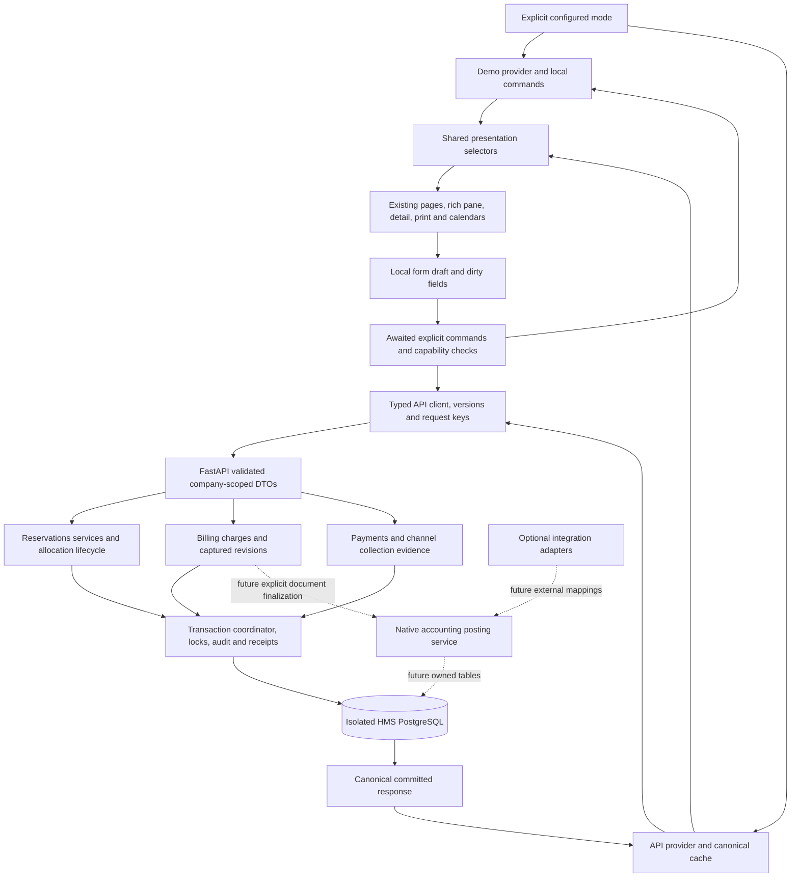

# Integration architecture for full operational parity

Date: 2026-10-13, Asia/Manila. Proposed design only; no application change in this audit. Preserve the rich frontend rather than make the narrow API branch its permanent replacement.

## Current architecture and the reason for the mismatch

[src/main.tsx](../../src/main.tsx) mounts [src/app/App.tsx](../../src/app/App.tsx), which selects demo or a lazy API branch by explicit runtime configuration. Demo routing uses [router.tsx](../../src/app/router.tsx) and [ReservationDemoContext](../../src/app/ReservationDemoContext.tsx). Its raw setters hold independent reservations, stays, guests, configuration and settlements in memory. [useReservationActions](../../src/app/useReservationActions.ts) applies local lifecycle results to related collections. Reload loses those records.

API mode uses [ApiApp](../../src/app/api/ApiApp.tsx), [ApiProvider](../../src/app/api/ApiProvider.tsx), [client](../../src/app/api/client.ts), typed [contracts](../../src/app/api/contracts.ts), [presentation](../../src/app/api/presentation.ts) and [ApiPages](../../src/pages/api/ApiPages.tsx). It loads canonical persisted data, handles errors and connects supported create/PATCH. It does **not** mount the existing full reservation detail/pane, print, inventory, discounts or configuration editors. Rooms/settings become read-only references; some sidebar entries disappear. That was a limited implementation choice, not a requirement imposed by PostgreSQL or FastAPI.

The isolated mode and typed client are useful foundations. The permanent integration should retain them while restoring the existing UI routes and business surfaces. No wholesale routing/state-library rewrite is necessary. The [matrix](frontend-backend-parity-matrix.md) records exact component and contract gaps.

## Proposed component and data boundaries

Introduce a small shared presentation/command interface at the existing app boundary. Use it to supply read models, explicit asynchronous commands and capabilities to existing pages. Migrate components incrementally away from direct useReservationDemo/raw setters; do not masquerade an API provider as a demo store accepting arbitrary full snapshots. Keep the existing demo provider and domain functions as the demo command implementation. Keep current API provider/client as the persistent implementation.

Example command responsibilities: createGuest, createReservation, patchReservationNotesCounts, editAllocations, checkIn/checkOut/cancel/noShow/recordDeparture, setRoomReadiness, configuration commands, bill-line/selection changes, collection and settlement commands. The last groups remain unavailable until their backend package is verified. A command returns canonical state after successful commit, not an optimistic replacement snapshot.

Existing ReservationPane has synchronous void onCreated/onSaved callbacks; submitReservation is async but currently invokes those callbacks without awaiting a persistence promise. Reusing it unchanged would close/reset a form before FastAPI completes. First extract a bounded awaited submit contract with existing dirty/discard behavior, a draft-to-supported-intent adapter and error/loading display. Preserve local fields until accepted success. Guest creation is a separate saved command; failed reservation creation must not pretend it rolled that guest back.

Reuse calendars, CalendarStayLayer, toolbar, line/discount explanations, SavedLineAmounts and audit rendering through supplied presentation props. Existing billing components must consume server-resolved saved amounts, not invoke current configuration pricing for the persisted bill. Current-rate comparisons remain clearly labeled informational comparisons. Draft prices may use a server quote; demo retains its existing local pipeline.

Solid persistent arrows beyond current create/read/PATCH are the **proposed** completed architecture, not claims of implementation. Demo never calls the API automatically. Accounting/adapters are future boundaries and are not part of operational parity implementation. ZKBioTime has no connection to any node.

## Authority and presentation contract

| Data | Authority in API mode | Presentation obligation |
|---|---|---|
| Reservation/allocation/guest/room identity | Database UUID | Keep UUID even when displaying room number or human business code |
| Reservation version | Accepted command response/current GET | Never derive it from price revision or increment it locally |
| Price and original rate | Captured server pricing snapshot | Show captured units/quantity/currency/discount allocation; do not reprice from references |
| New booking quote | Server pricing service when rich pricing arrives | Estimate pending commit; server revalidates inputs/reference versions |
| Scheduled/actual instants | Offset-aware raw canonical strings | Asia/Manila display; keep raw precision independently of JS Date |
| Availability/physical occupancy/readiness | Backend allocations, room state and lifecycle | Frontend derived visual projection is not permission to write |
| Reference configuration | Backend owned read/write services | Preserve archived historical choices and explicit clearing |
| Audit actor/time/raw before-after | Server | Current local-development actor is not authenticated staff |
| Form drafts | Browser component | Do not replace dirty input during refresh, error or conflict |
| Financial corrections/posting | Separate approved commands | UI cannot turn an adjustment removal into a ledger reversal |

Current presentReservation deliberately retains canonical DTO alongside a Date/Stay projection. Keep this pattern. JS Date cannot retain PostgreSQL microseconds: display projection is allowed, round-tripping it to an unchanged saved instant is not. Current business_number can key the one-room calendar, but multi-room projection must key each allocation by its UUID (or an explicit stable presentation key). Never hash/cast UUID into the existing numeric identity and hope collisions cannot occur. Adapt Stay identity consumers in one bounded task before W2 integration.

Frontend ReservationSnapshot is richer and shaped differently from current backend DTO. Missing catalog, discounts, terms, audit details and housekeeping must remain explicitly unsupported/unknown, not invented empty values interpreted as a complete saved record. Introduce small projection types where necessary rather than force casts or fabricate SampleGuest segment/stayCount. A richer canonical DTO is a backend contract milestone, not an adapter trick.

## Loading and cross-page consistency

ApiProvider already aborts obsolete bootstrap effects, guards refresh generations and prevents a refresh racing with a local successful mutation from replacing newer data. It upserts canonical reservations and refuses lower versions. Preserve those checks. Receipt replay can legitimately contain an older version than GET; display command success while retaining the newest cached record.

Current bootstrap independently fetches references, guests and all reservation pages. This is not a single database snapshot across pages. For a small local dataset it is useful, but full availability cannot be inferred from an incomplete/stale page. Add server-side bounded interval reads and a coherent cursor/configuration version when growth requires it. Do not add an event bus solely to solve initial integration.

After each command, merge its canonical aggregate once and invalidate affected room/configuration/settlement read models. All pages should derive stays and billing summaries from the same canonical source instead of manually updating independent arrays. Future lifecycle responses should supply changed room state or cause an explicit refresh; displaying checkout while the room still appears occupied is a consistency failure.

Startup distinguishes loading, empty successful data and failure. Keep no-fallback behavior. During failed refresh, last-confirmed data can remain visible with a stale/error label and capability restrictions on decisions requiring fresh state. Deep-link detail should issue its canonical lookup rather than require the reservation to happen to be loaded in the first page. Manual refresh is currently available; automatic polling/live subscriptions are a later scaling choice, not a parity requirement.

## Mutation, failure and retry

1. Validate supported input shape and retain local dirty fields.
2. Generate one request UUID for the normalized command intent; snapshot expected_version.
3. Disable duplicate submission while in flight; show pending rather than saved.
4. Await successful canonical response and commit before clearing/closing.
5. For definitive 422, show field errors without losing draft. For allocation conflict, explain unavailable room. For version conflict, fetch latest, compare dirty fields, preserve the user's proposal and require explicit reviewed resubmission.
6. For timeout/disconnect/invalid response after possible commit, retain the **original key/body/target** and retry that exact intent. Changing it while outcome is unknown risks duplicate bookings.
7. On confirmed success, install only canonical data. Never synthesize a locally saved persistent booking.

Current useMutation implements same-mounted-form uncertain retry; it loses request.current on unmount/reload. A receipt survives server restart but that does not protect a user who generates a fresh browser key after navigation. Before claiming robust restart/refresh recovery, choose a bounded session recovery record with company/operation/target/body/key and explicit expiry/clear policy, or block unsafe navigation until resolution. Storing guest data locally requires a deliberate retention design. UI drafts are not a second business database; no offline write queue or demo fallback is proposed.

Server keys remain operation/company scoped; target-binding already exists for PATCH. Different payload under the same key is rejected. Stale rejection writes no receipt, permitting a reviewed new attempt under a fresh key. Equal-value accepted PATCH increments once, so rich-pane no-op save must avoid issuing a request. These are existing contract semantics, not matters for the UI to silently reinterpret.

## Capabilities without removing the UI

Restore route shells, visual hierarchy, pane sections and expanded details. Until a package is implemented, show an honest unavailable explanation beside that action and disable its mutation. Keep demo behavior fully usable and separate. Do not hide all inventory/discount navigation or replace the original forms with a smaller permanent product.

A static verified capability map per API contract version is sufficient initially; later a server response can advertise supported operations. It must be fail-closed for unknown capabilities. UI flags are usability controls, not authorization. Every unsupported field/action must also be rejected by FastAPI. Existing local ChannelCapabilities and actor labels do not enforce staff permissions at the server.

Temporary unavailability is an integration stage; full operational parity requires implementing the existing catalog/discount/channel/configuration commands, not relabeling them all read-only and declaring completion. New login, legal invoices, stock ledger, full guest CRM, provider sync and journals are separately scoped because the demo does not implement them.

## Compatibility risks and acceptance gates

| Risk | Concrete source evidence | Required gate |
|---|---|---|
| Early close/reset | ReservationPane onCreated/onSaved are void and unawaited | Failed persistence retains open draft; success only after commit |
| Full snapshot submitted to narrow PATCH | Rich ReservationSnapshot vs strict ReservationEdit | Explicit intent mapping; unsupported fields cannot sneak through |
| Room number used as identity | Pane/pricing joins and room:number lines | UUID allocation/charge identity, safe rename/reassignment |
| One stay assumed everywhere | Unique allocation FK and presentReservation singular allocation | Compatible multi-room DTO and calendar key migration |
| Duplicate pricing engines | Frontend pricing pipeline vs accommodation-only server resolver | Golden parity fixtures and canonical server billing |
| Timestamp loss | JS Date projection versus raw ISO microseconds | Unchanged instants never round-trip through display controls |
| Incomplete audit | AuditRead omits raw before/after | Versioned detailed read and visibility contract |
| Reload loses retry key | useMutation request stored in useRef | Lost-response navigation/reload test and recovery decision |
| Fixture-derived facts | SampleGuest segment/stayCount, sample agreement/room metadata | Derived true data or explicit unknown, no invented business records |
| No authenticated staff | backend/context.py local-development | Separate production authorization/actor task before public use |

Verification must exercise the same supported workflow through demo and API views without weakening demo tests. For API mode: real PostgreSQL browser create/edit/refresh/restart, contention, 409 preserving user input, network loss without phantom records, all-page consistency, saved historical prices and unsupported actions. This audit did not run those mutation scenarios; current historical evidence covers only the narrow implemented slice.
